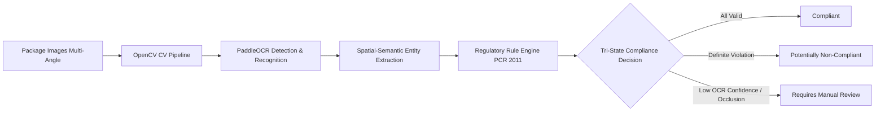

# LabelGuard AI 🛡️
### AI-Powered Packaged Commodity Compliance Intelligence Platform
**Smart India Hackathon (SIH26034) Reference Implementation**

[](https://fastapi.tiangolo.com)
[](https://python.org)
[](https://docs.sqlalchemy.org/en/20/)
[](https://pytest.org)
[]()

---

## 📌 Executive Summary

Under **The Legal Metrology Act, 2009** and the **Legal Metrology (Packaged Commodities) Rules, 2011 (PCR 2011)**, pre-packaged commodities sold across India must display mandatory declarations on their packaging. Enforcement by inspectors is traditionally manual, sampling-constrained, and prone to human oversight.

**LabelGuard AI** is an automated, auditable, and production-quality compliance intelligence platform. It analyzes multi-surface packaged commodity images, performs computer vision normalization (OpenCV), extracts text and spatial bounding boxes (PaddleOCR), parses entities using spatial-semantic heuristics, and evaluates declarations against a deterministic, statutory rule engine.

---

## ⚖️ Statutory Regulatory Foundation

All compliance checks in LabelGuard AI are strictly grounded in verified Indian statutes:
- **The Legal Metrology Act, 2009 (Act No. 1 of 2010)** — Sections 11, 18, and 36.
- **The Legal Metrology (Packaged Commodities) Rules, 2011 (PCR 2011)** with amendments:
  - **Rule 6(1)(a):** Name and complete physical address of Manufacturer, Packer, or Importer.
  - **Rule 6(1)(aa):** Country of origin / assembly / manufacture.
  - **Rule 6(1)(b):** Common or generic commodity name.
  - **Rule 6(1)(c) & Rules 11, 12, 13:** Standard metric net quantity declarations.
  - **Rule 6(1)(c) Syntax:** Statutory prohibition of non-standard abbreviations (e.g. `gms`, `kilos`, `ML`, `cc`).
  - **Rule 6(1)(d):** Month and year of manufacture, packing, or import (`MM/YYYY` or `Month YYYY`).
  - **Rule 6(1)(e):** Maximum Retail Price in statutory syntax: `MRP Rs. / ₹ xx.xx (incl. of all taxes)`.
  - **Rule 6(1)(e) USP Amendment:** Mandatory Unit Sale Price (`₹ per g/ml` or `₹ per kg/l`).
  - **Rule 6(1)(n):** Consumer Care Cell details (Helpline telephone, email ID, contact person/office, and address).
  - **Rule 9:** Prominence, legibility, and background contrast.

### Defensive Tri-State Compliance Logic
To prevent false-positive non-compliance accusations caused by poor photo quality:
- **`COMPLIANT`:** All mandatory declarations detected and verified against statutory formats.
- **`POTENTIALLY_NON_COMPLIANT`:** Mandatory declarations missing or format violations detected in readable, high-confidence regions ($\ge 0.75$).
- **`REQUIRES_MANUAL_REVIEW`:** Low OCR confidence ($< 0.70$), glare, or visual occlusions flag the image for human inspector verification rather than prematurely declaring a legal violation.

---

## 🏗️ System Architecture



### Technology Stack
- **Backend:** Python 3.13+, FastAPI, Pydantic v2, SQLAlchemy 2.0 Async, PyJWT, bcrypt.
- **Database:** PostgreSQL (Production / Render) with async fallback to SQLite (`aiosqlite`) for local development.
- **Computer Vision & AI:** OpenCV (CLAHE, bilateral filtering, deskewing), PaddleOCR (PP-OCRv4 DBNet + SVTR).
- **Frontend (Upcoming):** React 18, Vite, Tailwind CSS, Lucide Icons, React Router.

---

## 📁 Repository Structure

```text
LabelGuard/
├── backend/
│   ├── app/
│   │   ├── api/
│   │   │   ├── deps.py                  # JWT Auth & Role-Based Access Control
│   │   │   └── v1/
│   │   │       ├── api.py               # Aggregated V1 API Router
│   │   │       └── endpoints/
│   │   │           ├── auth.py          # /login, /register, /me
│   │   │           ├── health.py        # /health diagnostic & DB ping
│   │   │           ├── products.py      # Commodity catalog CRUD
│   │   │           ├── rules.py         # Statutory PCR 2011 rule registry
│   │   │           └── users.py         # Admin user management
│   │   ├── core/
│   │   │   ├── config.py                # Pydantic v2 settings & environment loader
│   │   │   └── security.py              # Raw bcrypt password hashing & JWT encoding
│   │   ├── database/
│   │   │   ├── base.py                  # Declarative base & UUID mixins
│   │   │   ├── init_db.py               # Superadmin & PCR 2011 statutory rule seeder
│   │   │   └── session.py               # Async session engine (SQLite/PostgreSQL)
│   │   ├── models/                      # SQLAlchemy 2.0 ORM Models
│   │   │   ├── audit.py                 # AuditLog table
│   │   │   ├── inspection.py            # Inspection, InspectionImage, OCRToken, ExtractedDeclaration
│   │   │   ├── product.py               # Product catalog table
│   │   │   ├── report.py                # InspectionReport table
│   │   │   ├── rule.py                  # ComplianceRule & ComplianceFinding tables
│   │   │   └── user.py                  # User table (ADMIN, INSPECTOR)
│   │   ├── schemas/                     # Pydantic v2 validation & response models
│   │   └── main.py                      # FastAPI lifespan, CORS, static mounts
│   ├── tests/
│   │   └── test_backend_core.py         # Pytest async integration test suite
│   ├── .env.example                     # Example environment variables
│   ├── pytest.ini                       # Asyncio test configuration
│   └── requirements.txt                 # Backend dependencies
├── .gitignore                           # Git ignore rules
└── README.md                            # Project documentation
```

---

## 🚀 Getting Started

### 1. Prerequisites
- Python 3.10+ (Tested on Python 3.13)
- Node.js v18+ (for upcoming frontend)
- Git

### 2. Backend Setup
```bash
# Navigate to backend directory
cd backend

# Create and activate virtual environment
python -m venv venv

# Windows
venv\Scripts\activate
# Linux/macOS
source venv/bin/activate

# Install dependencies
pip install -r requirements.txt

# Copy environment configuration
cp .env.example .env

# Run FastAPI development server
uvicorn app.main:app --reload --port 8000
```

The interactive OpenAPI documentation will be accessible at:
- **Swagger UI:** `http://localhost:8000/docs`
- **ReDoc:** `http://localhost:8000/redoc`
- **Health Check:** `http://localhost:8000/api/v1/health`

### 3. Running Automated Tests
```bash
cd backend
pytest -v
```

---

## 🗺️ 10-Phase Roadmap

- [x] **Phase 1: Requirements Analysis & Statutory Architecture**
- [x] **Phase 2: Database Schema & Backend Core Initialization**
- [ ] **Phase 3: Multi-Panel Image Upload & OpenCV Preprocessing Engine**
- [ ] **Phase 4: PaddleOCR Integration & Bounding Box Normalizer**
- [ ] **Phase 5: Spatial-Semantic Declaration Extraction Engine**
- [ ] **Phase 6: Deterministic Compliance Rule Engine (PCR 2011)**
- [ ] **Phase 7: React Frontend & Interactive Dashboard**
- [ ] **Phase 8: Frontend-Backend Full-Stack Integration**
- [ ] **Phase 9: PDF Audit Dossier Generation & Analytics**
- [ ] **Phase 10: E2E Benchmarking, Security Hardening & Deployment**
